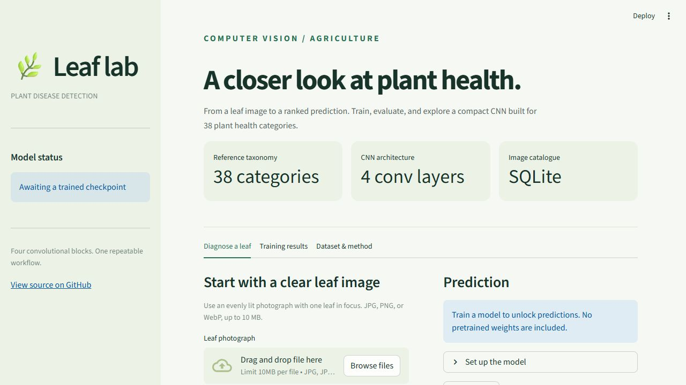

<p align="center"></p>

# Plant Disease Detection

[](https://github.com/pranjalsinggh/plant-disease-detection/actions/workflows/ci.yml)


A complete image-classification workflow for identifying healthy and diseased plant leaves across **38 categories**. It combines a **four-layer convolutional neural network**, a **SQLite image catalogue**, repeatable training and evaluation commands, and a **Streamlit prediction workspace**.

**No pretrained weights or plant images are bundled.** Bring a labelled dataset, train a checkpoint, and the app will use it. The interface starts cleanly without a model and never substitutes random predictions for a trained classifier.

## What is included

- Four convolutional blocks with ReLU, max-pooling, and dropout; a compact classification head.
- A transactional image index with SHA-256 checks, dimensions, class labels, and actual split counts. Images stay on disk and load as needed.
- Corrupt-image validation and detection of exact duplicate content across splits.
- Seeded training, augmentation, Adam, learning-rate scheduling, early stopping, and the best validation checkpoint.
- Per-epoch loss and accuracy, class-level precision/recall/F1, and a confusion matrix exported from actual runs.
- Top-three predictions with model scores, uploaded-image preview, and downloadable JSON.
- Automated checks and a generated-image smoke workflow that needs no external dataset.

## Run the app

Use Python 3.11 or newer. Run these commands from the repository root:

```bash
git clone https://github.com/pranjalsinggh/plant-disease-detection.git
cd plant-disease-detection
python -m venv .venv
```

Activate the environment:

```powershell
# Windows PowerShell
.venv\Scripts\Activate.ps1
```

```bash
# macOS / Linux
source .venv/bin/activate
```

```bash
python -m pip install --upgrade pip
python -m pip install -e ".[dev]"
python -m streamlit run app.py
```

Open `http://localhost:8501`. Predictions become available when `artifacts/run/best.pt` exists. You can inspect the app before downloading data or training.

For a particular CUDA configuration, install the appropriate PyTorch build from the [official installation guide](https://pytorch.org/get-started/locally/) before installing this package. CPU training is supported, but full-dataset training is faster on a GPU.



## Train with your dataset

Download a compatible labelled dataset, such as the [New Plant Diseases Dataset](https://www.kaggle.com/datasets/vipoooool/new-plant-diseases-dataset), and locate the extracted folder containing `train` and `valid`. See [the dataset guide](docs/DATASET.md) for the taxonomy, indexing options, and split considerations.

```text
data/dataset/
├── train/
│   ├── Apple___Apple_scab/
│   ├── Apple___healthy/
│   └── ...
├── valid/
│   ├── Apple___Apple_scab/
│   ├── Apple___healthy/
│   └── ...
└── test/                    # optional; must have class-labelled subfolders
```

The unlabelled sample `test` folder in some Kaggle archives is not an evaluation set. Keep it outside the indexed dataset root, or replace it with a held-out, class-labelled test split.

```bash
python -m plant_disease.index --data-dir data/dataset --database data/index.sqlite
python -m plant_disease.train --index data/index.sqlite --config configs/train.json --output artifacts/run
```

Edit [configs/train.json](configs/train.json) to change image size, batch size, epochs, learning rate, and early-stopping patience. The saved checkpoint includes the exact label order and preprocessing size used during training.

Evaluate the trained checkpoint and make a command-line prediction:

```bash
python -m plant_disease.evaluate --index data/index.sqlite --checkpoint artifacts/run/best.pt --split valid --output artifacts/evaluation
python -m plant_disease.predict --checkpoint artifacts/run/best.pt --image path/to/leaf.jpg --top-k 3
```

Validation guides checkpoint selection. Use `--split test` with a genuinely held-out test split for the final assessment.

## Architecture


Images are scaled to `[-1, 1]`. Augmentation is enabled only for training. Cross-entropy receives logits; softmax is applied for prediction scores. The model is trained from scratch, without a pretrained backbone.

## Results and provenance

The repository owner supplied these figures as the original project brief:

| Reference measure | Supplied value |
| --- | ---: |
| Training images | Approximately 79,000 |
| Image-entry capacity target | 100,000+ |
| Categories | 38 |
| Training accuracy | 95.94% |
| Validation accuracy | 94.03% |
| Training loss | 1.8891 → 0.1929 |

**These are supplied reference figures, not verified results from this implementation.** No original dataset, checkpoint, epoch history, or evaluation report was provided. This implementation does not claim to reproduce the original architecture's exact hyperparameters or its accuracy. Reference values are stored separately in [docs/reference_results.json](docs/reference_results.json) and never populate measured training reports.

Every training run writes its own results:

```text
artifacts/run/
├── best.pt          # model tensors, class order, preprocessing, and best-epoch metadata
├── history.csv      # measured per-epoch training and validation metrics
└── run.json         # configuration, dataset counts, and actual run summary
```

Evaluation exports metrics and a confusion matrix. The prediction app reads the configured checkpoint and training history; it does not display reference accuracy as the loaded model's performance.

## Verify without downloading plant images

```bash
python -m pytest -q
python -m ruff check .
```

The 27 tests generate temporary images and exercise model shapes, index validation, checkpoint loading, a small training/evaluation/prediction cycle, and app startup. These validate software behavior, not plant-disease accuracy.

For a manual synthetic workflow:

```bash
python scripts/create_smoke_dataset.py --output work/smoke-data
python -m plant_disease.index --data-dir work/smoke-data --database work/smoke.sqlite
python -m plant_disease.train --index work/smoke.sqlite --config configs/smoke.json --output work/smoke-run --device cpu
python -m plant_disease.evaluate --index work/smoke.sqlite --checkpoint work/smoke-run/best.pt --split valid --output work/smoke-evaluation
```

These generated patterns are **not real leaves** and their accuracy is not a disease-detection benchmark. Use `work/` for smoke artifacts to keep them separate from real model runs.

Test image-entry indexing capacity independently:

```bash
python scripts/benchmark_index.py --rows 100000 --output work/index-benchmark.json
```

This inserts **synthetic metadata**, not 100,000 image files. It measures catalogue capacity independently of image decoding, hashing, storage throughput, and CNN training. See [validation notes](docs/VALIDATION.md) for the recorded verification performed when this repository was created.

## Configuration

| Environment variable | Default | Purpose |
| --- | --- | --- |
| `PLANT_DISEASE_CHECKPOINT` | `artifacts/run/best.pt` | Trusted local model checkpoint |
| `PLANT_DISEASE_RUN_DIR` | Checkpoint's parent folder | Folder containing `run.json` and `history.csv` |
| `PLANT_DISEASE_INDEX` | `data/index.sqlite` | Catalogue displayed in the app |

Relative environment paths resolve against the working directory. Only load checkpoints from trusted sources. Datasets, model weights, secrets, and generated artifacts are excluded from Git.

## Project layout

```text
app.py                         Streamlit prediction and results workspace
src/plant_disease/
    index.py                   SQLite catalogue and dataset validation
    labels.py                  38 reference category names
    model.py                   Four-layer CNN
    transforms.py              Shared image preprocessing
    train.py                   Training and checkpoint selection
    evaluate.py                Evaluation and classification reports
    predict.py                 Inference API and CLI
    artifacts.py               Checkpoint validation and loading
configs/                       Full training and smoke configurations
scripts/                       Synthetic fixtures and index benchmark
tests/                         Automated behavior checks
docs/                          Dataset guide, model card, and validation notes
```

## Model limitations

This is an image **classifier**, rather than a detector that localizes lesions. It is limited to the classes present in the training checkpoint. Softmax scores are not calibrated confidence estimates and do not identify unfamiliar diseases or non-leaf images reliably. Exact duplicate checks cannot detect all augmented copies of the same leaf; keep related images together before splitting. Controlled-background datasets may perform differently on photographs taken in the field.

Read [the model card](docs/MODEL_CARD.md) for the intended use and evaluation protocol. Code is licensed under [MIT](LICENSE); dataset and external model licenses remain separate.

## Sources

- [New Plant Diseases Dataset — Kaggle](https://www.kaggle.com/datasets/vipoooool/new-plant-diseases-dataset)
- [Original PlantVillage dataset](https://github.com/spMohanty/PlantVillage-Dataset), a distinct source dataset
- [Mohanty, Hughes & Salathé (2016), Using Deep Learning for Image-Based Plant Disease Detection](https://doi.org/10.3389/fpls.2016.01419)
- [PyTorch documentation](https://docs.pytorch.org/docs/stable/index.html)
- [Streamlit documentation](https://docs.streamlit.io/)
